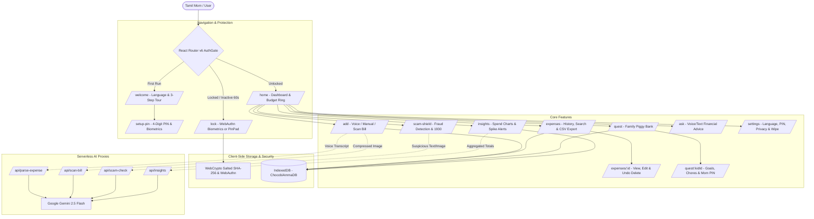

# 🌸 Chocobi Amma AI (சோகோபி அம்மா AI)
> **அம்மாவுக்கான அன்பான குடும்ப நிதி காப்பாளர்**  
> *The Warm Family Finance Guardian for Tamil Mothers*

Built with **React 19 + TypeScript + Vite + Tailwind CSS**, architected as an installable **Progressive Web App (PWA)** optimized for mobile viewports (360px–430px) and fully responsive on desktop.

---

## 🌟 Overview

**Chocobi Amma AI** is a family finance guardian and savings companion tailored specifically for mothers across Tamil Nadu (ages 30–60), many of whom find conventional fintech applications intimidating, overly complex, or disconnected from their linguistic and cultural reality.

- 🎙️ **Voice Expense Logging:** Speak naturally in Tamil or English (e.g., *"இன்னைக்கு காய்கறி 250 ரூபாய், ஆட்டோ 80"* or *"Milk 60 rs"*). Uses native Web Speech API with Gemini structured extraction and offline regex fallback. Never auto-saves without Mom's explicit review and approval.
- 📸 **Bill Scanner:** Upload or snap a receipt photo (auto-compressed client-side to < 1MB) to extract merchant, line items, and totals.
- 🛡️ **Scam Shield:** Paste suspicious SMS/WhatsApp/UPI collect requests or upload screenshots. Gemini analyzes fraud patterns (fake KYC, electricity cutoff threats, fake lottery links, OTP tricks) and produces a 6th-grade level Tamil/English verdict with a direct tap-to-call link for the National Cyber Crime Helpline **1930** and instant family sharing via Web Share API.
- 🍪 **Chocobi Quest:** Gamified savings piggy bank where moms and children track financial goals (school bag, bicycle, festival fund) and earn chocolate biscuit points. Chores require Mom's 4-digit PIN approval before points are awarded.
- 📊 **Plain-Language Insights:** Interactive monthly charts (Recharts) coupled with maternal AI summaries and recurring bill reminders.
- 🔒 **Bank-Grade On-Device Security:** WebCrypto salted SHA-256 PIN hashing, WebAuthn platform biometrics, 60s background auto-lock, and 5-attempt escalating lockout cooldowns.

---

## 🏗️ Architecture



---

## 🎨 Design System: "Pongal Warmth"

Inspired by the cultural warmth of Tamil homes, festive Pongal celebrations, and strict WCAG 2.1 AA accessibility guidelines:

| Token | Color | Hex Code | Purpose & Contrast Ratio |
|---|---|---|---|
| **Background Cream** | Cream | `#FFF8EC` | Warm, non-glare background (11.5:1 text contrast) |
| **Surface White** | Pure White | `#FFFFFF` | Card surfaces and elevation |
| **Kumkum Rose** | Deep Rose | `#C2185B` | Primary actions, CTA buttons, active states (> 4.9:1) |
| **Turmeric Gold** | Turmeric | `#FFB300` | Secondary accents, festive badges, biscuit points |
| **Leaf Green** | Green | `#2E7D32` | Safe verdicts, within-budget indicators (5.5:1) |
| **Alert Red** | Crimson | `#D32F2F` | Scam warnings, budget exceed alerts (5.1:1) |
| **Warm Brown** | Dark Brown | `#3E2723` | High-contrast body typography (> 11.5:1 WCAG AAA) |

### Key UI Features
- **Original Mascot: "Chocobi Amma"**: An inline SVG character component `<Mascot mood="happy|thinking|alert|celebrate" />` featuring traditional vermillion bindi (*Kumkum Pottu*), jasmine flowers (*Mallipoo*), nose pin (*Mookuthi*), and a small chocolate biscuit emblem.
- **Kolam Motifs**: Traditional dot patterns (*Sikku Kolam*) adorn cards, splash screens, and empty states.
- **Large Touch Targets**: Minimum button height of 56px, high-contrast numeric keypads, and visible focus rings.
- **Bilingual i18n System**: Strict Tamil (`ta`) and English (`en`) dictionaries with zero hardcoded UI strings.

---

## 🔒 Security & Privacy Guarantees

1. **Zero Cloud Credential Storage:** The raw 4-digit PIN is never stored or transmitted. IndexedDB stores only a random 16-byte salt and its salted SHA-256 hash generated via the native browser `crypto.subtle` API.
2. **Hardware Biometrics:** Uses WebAuthn Platform Authenticator (`userVerification: "required"`). Fingerprint and FaceID processing happens exclusively inside the device hardware enclave.
3. **Escalating Lockout Protection:** 5 consecutive incorrect PIN attempts trigger a mandatory 30-second cooldown timer.
4. **Auto-Lock on Inactivity:** Automatically locks whenever the app is hidden or backgrounded for more than 60 seconds (`visibilitychange` API).
5. **Zero-Data-Retention AI Proxies:** Vercel serverless functions strip sensitive data before querying Gemini 2.5 Flash with structured JSON schemas. No conversation or financial logs are stored on servers.

---

## 🚀 Getting Started

### Prerequisites
- Node.js 18+
- npm or pnpm

### 1. Installation
```bash
git clone https://github.com/your-username/chocobi-amma-ai.git
cd chocobi-amma-ai
npm install
```

### 2. Environment Variables
Create a `.env` file in the project root:
```env
GEMINI_API_KEY=your_gemini_api_key_here
GEMINI_MODEL=gemini-2.5-flash
```

### 3. Development Server
```bash
npm run dev
```
Open [http://localhost:5173](http://localhost:5173) in your browser. Set your browser DevTools to a mobile viewport (e.g. 390px × 844px).

---

## 🧪 Testing Suites

Run unit, integration, and E2E suites:

```bash
# 1. Run Vitest Unit & Integration Suite
npm test

# 2. Run TypeScript Static Analysis
npm run typecheck

# 3. Run Mobile E2E Tests (Playwright)
npm run e2e

# 4. Run Axe-Core Accessibility Check
npx playwright test tests/accessibility.spec.ts
```

For manual testing scenarios, refer to [`tests/manual-checklist.md`](./tests/manual-checklist.md).

---

## 🌐 Deploy to Vercel

The project is pre-configured with `vercel.json` for seamless deployment:

1. Push your repository to GitHub.
2. Import the project in the [Vercel Dashboard](https://vercel.com).
3. Under **Environment Variables**, add `GEMINI_API_KEY`.
4. Deploy! All SPA routes, serverless `/api/*` endpoints, security headers, and PWA assets are configured automatically.

---

## 🎬 2-Minute Demo Script

| Timestamp | Screen | Action & Voiceover |
| :--- | :--- | :--- |
| **0:00 - 0:20** | `/welcome` | *"வணக்கம்! This is Chocobi Amma AI, built for Tamil mothers. We select Tamil, review the warm 3-card tour explaining voice expense logging, scam shielding, and kids quest."* |
| **0:20 - 0:40** | `/setup-pin` & `/lock` | *"Mom sets a 4-digit PIN (1-2-3-4). Notice the native WebAuthn biometric prompt. When the app is locked or left in background for 60 seconds, it securely prompts for PIN with escalating lockout."* |
| **0:40 - 1:10** | `/home` & `/add` | *"On the Home screen, Mom taps the pulsing Big Mic: 'இன்னைக்கு காய்கறி 250 ரூபாய், ஆட்டோ 80'. Gemini parses it into two items. Mom reviews the confirmation card, edits if needed, and saves. Instantly added to her budget ring!"* |
| **1:10 - 1:35** | `/scam-shield` | *"Mom pastes a fake TNEB electricity bill cutoff SMS. Amma's mascot changes to 'Alert' mood, displaying a bold red Scam Verdict with reasons and a one-click button to call the National Cyber Crime Helpline 1930."* |
| **1:35 - 2:00** | `/quest` & `/insights` | *"In Chocobi Quest, Mom approves her child's chore using her PIN, triggering a festive confetti celebration and biscuit points. Finally, in Insights, Mom sees plain-language Tamil advice on saving on groceries."* |

---

## 📄 License
MIT License. Built with love for mothers everywhere. 🌸
